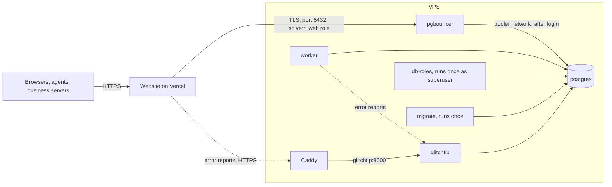

#  Deployment

**The website and API on Vercel, and the worker, database, error tracking and backups on one VPS.**

##  Overview

The website and API run on **Vercel**. Everything else runs on **one VPS** with Docker Compose (`deploy/docker-compose.yml`, project name `solverr`): Postgres, PgBouncer, the worker, migrations, GlitchTip and backups. Vercel functions cannot run the always-on worker, which checks open payments every 5 seconds. Run every command below from the repository root.

- **Website:** the branch Vercel deploys changes -> Vercel builds and serves the pages, the API, the MCP server and the Telegram webhook.
- **VPS:** `docker compose -f deploy/docker-compose.yml up -d --build` runs on the server -> the VPS services below start, and migrations run before the worker.
- **Database access:** the website logs in to PgBouncer over TLS with a client certificate -> only PgBouncer's port 5432 faces the internet, and Postgres is not published.
- **Backups:** a nightly `pg_dump` and, once set up, WAL-G archiving copy the database -> you can restore it from a dump or to a chosen moment.

### What runs where

| Where | Service | What it does |
| --- | --- | --- |
| Vercel | website | Next.js pages, the API, the MCP server and the Telegram webhook, on Node 24 (`engines` in `package.json`; Vercel applies its patch releases). `npm run build` runs `prisma generate`, builds `public/embed.js` from `packages/embed`, packs the WooCommerce plugin zip into `public/downloads/`, then `next build`. Security headers (HSTS, framing, CSP, permissions) come from `next.config.ts` |
| VPS | `postgres` | Postgres 17 with WAL-G (`deploy/Dockerfile.postgres`). Data in the `pgdata` volume. Not published: the server's containers reach it on the `backend` network, and the website only through `pgbouncer` on the `pooler` network. Access rules are in `deploy/pg_hba.conf`. WAL archiving to the backup bucket is on when `PG_ARCHIVE_MODE=on` |
| VPS | `pgbouncer` | PgBouncer 1.26 in session mode (`deploy/Dockerfile.pgbouncer`, `deploy/pgbouncer.ini`), published on IPv4 port 5432 for the website, with TLS from `deploy/postgres-tls/`. It admits only the `solverr_web` role over TLS (`deploy/pgbouncer_hba.conf`), checks its password itself, and opens a Postgres connection only after a client has logged in |
| VPS | `db-roles` | Creates the `solverr`, `solverr_web` and `glitchtip` roles and the databases as the `postgres` superuser (`deploy/db-roles.sql`), grants `solverr_web` its table rights and timeouts, and exits. It runs on every start; after the first time, it only updates the passwords and grants |
| VPS | `migrate` | Runs `prisma migrate deploy` once (worker image) as the `solverr` role; the worker starts only after it succeeds |
| VPS | `worker` | Background jobs (`deploy/Dockerfile.worker`, `tsx worker/index.ts`) on a read-only filesystem |
| VPS | `caddy` | HTTPS on 80/443 for `GLITCHTIP_HOST` with an automatic Let's Encrypt certificate; proxies to `glitchtip:8000`. It is on the `edge` network only and cannot reach Postgres, which is on `backend` and `pooler`; `glitchtip` is on `edge` and `backend` |
| VPS | `glitchtip` | GlitchTip 6 error tracking in all-in-one mode (no Valkey), 1 GB and at most 2 cores at low priority, built as `solverr-glitchtip` (`deploy/Dockerfile.glitchtip`). Its secrets are in `deploy/glitchtip.env`, which the worker never receives |



##  First Deploy

### 1. The VPS

Set up the VPS first (Ubuntu 24.04 or Debian 12 with Docker Engine and the Compose plugin):

1. Clone the repository and open its folder. Point `GLITCHTIP_HOST` (for example `errors.example.com`) and a database hostname (for example `db.example.com`) at the server. Names on sslip.io, such as `errors.203-0-113-5.sslip.io`, work without DNS setup.
2. Create the database certificates once: `sudo sh deploy/postgres-tls.sh db.example.com`. It writes `deploy/postgres-tls/` (Git ignores it): the server certificate PgBouncer shows, and the client certificate the website must show. Keep its output. `ca.crt`, `client.crt` and `client.key` go to Vercel in the next part. After that, delete `client.key` from the server.
3. Copy `deploy/postgres.env.example` to `deploy/postgres.env`, generate each of its three passwords with `openssl rand -hex 32`, and run `chmod 600 deploy/postgres.env`.
4. Copy `deploy/pgbouncer.env.example` to `deploy/pgbouncer.env`, generate the website's password `SOLVERR_WEB_DB_PASSWORD` with `openssl rand -hex 32`, and run `chmod 600 deploy/pgbouncer.env`.
5. Copy `deploy/.env.example` to `deploy/.env`, fill in every value, and run `chmod 600 deploy/.env`. Put the `SOLVERR_DB_PASSWORD` value from `deploy/postgres.env` into `DATABASE_URL`. Generate `ENCRYPTION_KEY` and `BETTER_AUTH_SECRET` with `openssl rand -base64 32`. Leave `SENTRY_DSN` empty for now.
6. Copy `deploy/glitchtip.env.example` to `deploy/glitchtip.env`, put the `GLITCHTIP_DB_PASSWORD` value into its `DATABASE_URL`, fill in the rest, and run `chmod 600 deploy/glitchtip.env`.
7. Open TCP port 5432 (PgBouncer) and ports 80/443 in the server's firewall, then start everything: `docker compose -f deploy/docker-compose.yml up -d --build`

### 2. Vercel

Then import the repository in Vercel as a Next.js project and set these Environment Variables before the first build. Every request talks to the database, so the functions must run close to the VPS: `vercel.json` pins them to Frankfurt (`fra1`). For a VPS elsewhere, change `regions` there to the nearest Vercel region.

| Variable | Value |
| --- | --- |
| `APP_URL` | The site's public address, such as `https://pay.example.com` (the same as in `deploy/.env`) |
| `DATABASE_URL` | `postgresql://solverr_web:<SOLVERR_WEB_DB_PASSWORD>@db.example.com:5432/solverr`, with the password from `deploy/pgbouncer.env` and without `sslmode`. Port 5432 is PgBouncer |
| `DATABASE_CA_CERT` | The whole contents of `deploy/postgres-tls/ca.crt` |
| `DATABASE_CLIENT_CERT`, `DATABASE_CLIENT_KEY` | The whole contents of `deploy/postgres-tls/client.crt` and `client.key`. Mark both as Sensitive, then run `sudo rm deploy/postgres-tls/client.key` on the server |
| `DATABASE_POOL_MAX` | `5` |
| `ENCRYPTION_KEY`, `BETTER_AUTH_SECRET` | The same values as in `deploy/.env` |
| `ONECLICK_API_KEY`, `ONECLICK_CONFIDENTIALITY`, `ONECLICK_BASE_URL`, `NEAR_RPC_URL`, `SOLANA_RPC_URL`, `EVM_RPC_URLS`, `RESEND_API_KEY`, `EMAIL_FROM`, `TELEGRAM_BOT_TOKEN`, `TELEGRAM_WEBHOOK_SECRET` | The same values as in `deploy/.env`, where set |
| `SENTRY_DSN` | The GlitchTip DSN as copied, with `https://` and `GLITCHTIP_HOST` |
| `NEXT_PUBLIC_WALLETCONNECT_PROJECT_ID` | The Reown project id (required); add the site's domain to the project's allowed domains at dashboard.reown.com |
| `NEXT_PUBLIC_SOLANA_RPC_URL`, `NEXT_PUBLIC_NEAR_RPC_URL` | Optional browser RPCs. `NEXT_PUBLIC_` values are built into the page and visible to everyone, so use keys restricted to the site's domain, and redeploy after changing them |

### 3. Check it

Add the site's domain in Vercel, then check `https://{site}/api/health/worker` and the worker log: `docker compose -f deploy/docker-compose.yml logs -f worker`. Set up error tracking, the uptime monitor, and optionally the Telegram bot (all below).

##  Error Tracking (GlitchTip)

Unexpected errors on the website (route and Server Action failures, render errors) and in the worker (failed jobs, a crash) go to GlitchTip through `@sentry/node` (`lib/error-reports.ts`). Reports carry the error, its stack (file and line, without source lines) and labels such as the job name or the route.

Request headers, bodies, cookies, query strings, users, local variables, breadcrumbs and sessions are never collected. Any URL in an error message is cut to its origin (scheme and host), because paths and queries can carry RPC keys or the Telegram bot token. There is no browser SDK, so the checkout loads no extra code.

Once, after the first deploy:

1. Create the first GlitchTip user, who can create organizations: `docker compose -f deploy/docker-compose.yml exec glitchtip ./manage.py createsuperuser` (sign-up on the page is off).
2. Sign in at `https://{GLITCHTIP_HOST}`, create an organization and a project (platform Node.js), and add yourself to its alert recipients.
3. Copy the project's DSN. Put it unchanged in `SENTRY_DSN` on Vercel. For the worker, replace `https://` and the host with `http://` and `glitchtip:8000` (so `https://abc@errors.example.com/1` becomes `http://abc@glitchtip:8000/1`) and put that in `SENTRY_DSN` in `deploy/.env`.
4. Redeploy on Vercel, and run `docker compose -f deploy/docker-compose.yml up -d` so the worker picks it up.

GlitchTip keeps events for 30 days. Its log is `docker compose -f deploy/docker-compose.yml logs glitchtip`.

##  Telegram Bot

The bot is off until both `TELEGRAM_BOT_TOKEN` and `TELEGRAM_WEBHOOK_SECRET` are set. Without them, `/api/telegram` answers 404.

1. Create a bot with @BotFather and put its token in `TELEGRAM_BOT_TOKEN`.
2. Put a random string in `TELEGRAM_WEBHOOK_SECRET` (`openssl rand -hex 32`).
3. Register the webhook once. The URL must be public HTTPS, so this works only on the deployed site:
   `curl "https://api.telegram.org/bot<token>/setWebhook" -d "url=<APP_URL>/api/telegram" -d "secret_token=<secret>"`
4. Set both values on Vercel and in `deploy/.env`, redeploy on Vercel, and run `docker compose -f deploy/docker-compose.yml up -d` so the worker picks them up. An owner or developer of a business links a private chat with the code from Settings → Telegram (`/connect CODE`).

##  Updates

To update, push to the branch Vercel deploys. Then, on the VPS, run `git pull` and `docker compose -f deploy/docker-compose.yml up -d --build`. Migrations run on the VPS before the worker starts.

### Releases that change the database schema

Vercel deploys as soon as the branch changes, so a release that changes the database schema goes out in this order:

1. Push the release to a separate branch (for example `release`), which Vercel does not deploy to production.
2. On the VPS, run `git fetch && git checkout <that commit>` and `docker compose -f deploy/docker-compose.yml up -d --build`. The `migrate` service applies the migration.
3. Merge the branch into the one Vercel deploys.

Write such migrations so the website version still running keeps working against the new schema (add columns and tables first, remove old ones in a later release).

##  Backups

### Nightly dump

`deploy/backup.sh` writes `pg_dump` output to `/var/backups/solverr/solverr-YYYYMMDD-HHMMSS.sql.gz` and deletes dumps older than 7 days. Add it to root's crontab on a server whose clock is UTC:

    0 3 * * * /path/to/repo/deploy/backup.sh >> /var/log/solverr-backup.log 2>&1

Each dump is written to a `.partial` file and checked with `gzip -t` before it gets its final name, so a failed dump never looks like a good one.

### Off-site copies

Local dumps do not survive the loss of the server, so the script can also copy each dump to free off-site storage and keep it there for 30 days. Set it up once, on the server:

1. Create a free storage bucket: Backblaze B2 (10 GB free) or Cloudflare R2 (10 GB free), and an access key limited to that bucket.
2. Install rclone (`apt install rclone`) and run `rclone config` as root:
   - add a remote for the bucket (type `b2`, or `s3` with provider Cloudflare for R2), for example `solverr-b2`;
   - add a second remote of type `crypt` named `solverr-offsite` that points at `solverr-b2:<bucket>/backups` and set its password. rclone then encrypts every dump before it leaves the server.
3. Store the crypt password in a password manager. Without it the off-site dumps cannot be decrypted.
4. Change the crontab line to `0 3 * * * BACKUP_REMOTE=solverr-offsite: /path/to/repo/deploy/backup.sh >> /var/log/solverr-backup.log 2>&1`.
5. Check the next morning: `rclone ls solverr-offsite:` lists the new dump.

The script refuses a `BACKUP_REMOTE` that is not a `crypt` remote, so an unencrypted dump never leaves the server. A run that starts while the previous one is still going stops.

The VPS provider's snapshots are a second free safety net for the whole server. Take one before each deploy. Keep a copy of `deploy/.env` in a safe place off the server too (a password manager, for example): without the same `ENCRYPTION_KEY` the stored webhook secrets cannot be read, and without `BETTER_AUTH_SECRET` every session stops working.

### Restore a dump

To restore, stop the worker and PgBouncer, replace the database, and start both again. `ON_ERROR_STOP` and `--single-transaction` make a failed restore change nothing instead of leaving half the data:

```bash
docker compose -f deploy/docker-compose.yml stop worker pgbouncer
docker compose -f deploy/docker-compose.yml exec -T postgres dropdb -U postgres --force solverr
# Creates the empty solverr database again, owned by the solverr role and closed to other roles.
docker compose -f deploy/docker-compose.yml run --rm db-roles
gunzip -c <file> | docker compose -f deploy/docker-compose.yml exec -T postgres psql -U solverr -d solverr -v ON_ERROR_STOP=1 --single-transaction
# Grants the website's solverr_web role the restored tables.
docker compose -f deploy/docker-compose.yml run --rm db-roles
docker compose -f deploy/docker-compose.yml start pgbouncer worker
```

While PgBouncer is stopped, the website on Vercel cannot reach the database and answers with errors, so it never reads a half-restored database. For a quiet restore, pause it in Vercel first.

Only the `postgres` superuser can drop the database. The app's `solverr` role owns it but cannot connect to the `postgres` maintenance database. The dump is made without owners, so everything restored belongs to `solverr`.

##  Point-in-Time Backups (WAL-G)

A nightly dump can lose up to a day of payments. WAL-G (built into the `solverr-postgres` image by `deploy/Dockerfile.postgres`) also copies every change (WAL) to a free bucket within 5 minutes, plus a nightly base backup, so you can restore the database to any moment. Everything is encrypted on the server first. The `pg_dump` above stays as a second, separate copy.

### Set up archiving

Setup, once:

1. Create a free bucket. Cloudflare R2 is the safer choice: WAL-G 3.0.9 has an open bug where large base backups to Backblaze B2 fail now and then. Create an access key limited to that bucket.
2. Copy `deploy/walg.env.example` to `deploy/walg.env`, fill it in, and run `chmod 600 deploy/walg.env`. Store `WALG_LIBSODIUM_KEY` in a password manager: without it the backups cannot be restored.
3. Set `PG_ARCHIVE_MODE=on` in `deploy/.env`, then run `docker compose -f deploy/docker-compose.yml up -d --build`. Postgres restarts once.
4. After 5 minutes, check that WAL arrives in the bucket. `archived_count` must grow and `failed_count` stay 0:
   `docker compose -f deploy/docker-compose.yml exec -T postgres psql -U solverr -d solverr -c "SELECT archived_count, failed_count, last_archived_time FROM pg_stat_archiver"`
5. Take the first base backup and list it:
   `docker compose -f deploy/docker-compose.yml exec -T -u postgres postgres sh -c 'wal-g backup-push "$PGDATA" && wal-g backup-list --pretty'`
6. Add the nightly base backup to root's crontab, before the 03:00 dump. It keeps 7 base backups and the WAL they need:
   `30 2 * * * docker compose -f /path/to/repo/deploy/docker-compose.yml exec -T -u postgres postgres sh -c 'wal-g backup-push "$PGDATA" && wal-g delete retain FULL 7 --confirm' >> /var/log/solverr-walg.log 2>&1`

While archiving fails, WAL stays on the database disk until the disk is full and Postgres stops. When archiving has failed for 15 minutes, the worker's `wal-archiving` job reports it to GlitchTip. `pg_stat_archiver` (step 4) shows the last error time.

### Restore to a moment

To restore to a moment, take a VPS snapshot first, because step 2 deletes the current database files:

```bash
docker compose -f deploy/docker-compose.yml stop worker glitchtip pgbouncer postgres
docker compose -f deploy/docker-compose.yml run --rm --no-deps -u postgres --entrypoint sh postgres -c \
  'find "$PGDATA" -mindepth 1 -delete && wal-g backup-fetch "$PGDATA" LATEST && touch "$PGDATA/recovery.signal"'
docker compose -f deploy/docker-compose.yml run --rm --no-deps postgres postgres \
  -c max_connections=200 -c max_locks_per_transaction=512 -c hba_file=/etc/postgresql/pg_hba.conf \
  -c archive_mode=on -c "archive_command=timeout 600 wal-g wal-push %p" \
  -c "restore_command=wal-g wal-fetch %f %p" -c "recovery_target_time=2026-11-09 12:00:00+00" -c recovery_target_action=promote
# Wait for "database system is ready to accept connections", press Ctrl+C, then:
docker compose -f deploy/docker-compose.yml up -d
```

`docker compose run` with a command replaces the service's whole `command`, so the restore command repeats the settings that recovery checks against the backup. Postgres refuses to recover with a lower `max_connections` or `max_locks_per_transaction` than the server that made the backup had, so change these two together with `deploy/docker-compose.yml`. Archiving stays on, so the new timeline is backed up from its first WAL.

Pick a `recovery_target_time` before `last_archived_time` (step 4): changes not yet in the bucket (up to `archive_timeout`, 5 minutes) cannot be replayed. A later target stops recovery with "recovery ended before configured recovery target was reached". Without `recovery_target_time`, recovery replays every archived change, up to the last one. Take a new base backup (step 5) after a restore.

##  Points That Cause Confusion

### Images and containers

- **Images are pinned to exact versions and digests** (`node:24.22.2-slim`, `postgres:17.11`, `golang:1.27.3-trixie`, `caddy:2.11.9`, `glitchtip/glitchtip:6.2.6`). To upgrade, change the tag and its `@sha256:` digest together everywhere it appears (`deploy/Dockerfile.*`, both compose files, `.github/workflows/ci.yml`). A tag alone would still pull the old image. Postgres's tag and digest are in `deploy/Dockerfile.postgres`, `deploy/Dockerfile.pgbouncer`, `deploy/docker-compose.dev.yml` and `.github/workflows/ci.yml`, and its tag alone is in the database-test command in `README.md`. Node's are in `deploy/Dockerfile.worker`, and `NODE_VERSION` in `.github/workflows/ci.yml` must match its version. GlitchTip's are in `deploy/Dockerfile.glitchtip`. WAL-G's version and release commit are in `deploy/Dockerfile.postgres`. The exact PgBouncer package version (`PGBOUNCER_VERSION`, from the PostgreSQL project's apt repository) is in `deploy/Dockerfile.pgbouncer`. PgBouncer often fixes flaws that work before login, so check its changelog (pgbouncer.org/changelog) every month and move that pin with each release.
- **Security updates come from rebuilding:** the worker, Postgres, PgBouncer and GlitchTip images apply Debian's security updates when they are built. The worker image has no npm (migrations run `node_modules/.bin/prisma`), WAL-G is compiled from its release commit with a current Go (`deploy/Dockerfile.postgres`, a few minutes on the first build), and `deploy/Dockerfile.glitchtip` moves GlitchTip's vulnerable Python packages to fixed releases and checks the app still loads. Run `docker compose -f deploy/docker-compose.yml build --pull --no-cache` and `docker compose -f deploy/docker-compose.yml up -d` on the VPS every month and after any Debian or Node security release. Then scan each image from a saved copy, so the scanner never gets the Docker socket (root on the server): `docker save <image> -o /tmp/image.tar && docker run --rm -v /tmp/image.tar:/image.tar:ro aquasec/trivy:0.76.1@sha256:790fd66d1697395d8693d1acaa1ea702406a20f109b6fc7bac8db623eca6c06c image --input /image.tar --severity HIGH,CRITICAL --ignore-unfixed; rm /tmp/image.tar`. Keep Trivy pinned by digest: in March 2026 the `latest` tag and two releases on Docker Hub carried an infostealer (CVE-2026-33634).
- **One builder per image:** `postgres` builds `solverr-postgres`, `pgbouncer` builds `solverr-pgbouncer` and `worker` builds `solverr-worker`. `db-roles` and `migrate` reuse them (`pull_policy: never`). Two services building the same image at once fail with "image already exists".
- **Memory and CPU limits assume the 12 GB, 6-core VPS:** postgres 5 GB (with `shared_buffers=1280MB` and `effective_cache_size=3840MB`), worker 2 GB (Node's heap stops at 1.5 GB), glitchtip 1 GB, pgbouncer 512 MB (enough for its 5000 client connections), migrate 512 MB, caddy 256 MB, db-roles 128 MB. That leaves about 3 GB for the system and image builds, plus a 4 GB swap file. Postgres and the worker may use every core and win under contention (`cpu_shares: 2048`); GlitchTip gets at most 2 cores at low priority. On a smaller server, lower them in `deploy/docker-compose.yml` before the first `up`, and change the Postgres cache settings with its limit.
- **Container privileges:** every service (`postgres`, `pgbouncer`, `db-roles`, `migrate`, `worker`, `glitchtip`, `caddy`) runs with every Linux capability dropped and `no-new-privileges`. Caddy gets back only `NET_BIND_SERVICE` for ports 80 and 443, and Postgres only `CHOWN`, `DAC_OVERRIDE`, `FOWNER`, `SETGID` and `SETUID`, which its entrypoint needs to fix the data folder's ownership and switch to the `postgres` user. PgBouncer also runs as a non-root user (uid 999) on a read-only filesystem. Its password file is written at start into the in-memory `/run/pgbouncer`. When the worker is stopped, Docker waits 60 s after `SIGTERM` before it kills the process.

### Database and secrets

- **Database connections from Vercel:** each function instance keeps up to `DATABASE_POOL_MAX` connections to PgBouncer, closed when idle (`attachDatabasePool` in `lib/db.ts`), plus one listening connection while a checkout's live updates are open (`lib/payments/checkout-events.ts`). PgBouncer runs in session mode: each logged-in client gets its own Postgres connection until it disconnects, as with a direct connection, so `LISTEN` and transactions work unchanged. The next client reuses a freed connection instead of opening a new one. Postgres allows 200 (`max_connections` in `deploy/docker-compose.yml`). The website logs in as `solverr_web`, which may hold at most 150 of them (`pool_size` in `deploy/pgbouncer.ini` and `CONNECTION LIMIT` in `deploy/db-roles.sql`), so the worker, migrations, GlitchTip and backups always find a connection however many function instances run. A client past those 150 waits up to 10 s (`query_wait_timeout`) for a free one and then fails, so keep `DATABASE_POOL_MAX` times the most instances you expect below 150. If every connection is still taken, the worker pauses its jobs as if the database were down and resumes once connections free up. Every query crosses the internet to the VPS, so keep the Vercel Function Region close to it.
- **Connection floods:** Postgres takes one of its 200 slots for every connection before it checks the password, so connections that never log in can fill them and stop the website and the worker. For that reason only PgBouncer faces the internet. A client that has not logged in costs it about 30 KB of memory, is dropped after 5 s (`client_login_timeout`), and never reaches Postgres. PgBouncer checks the password from its own file, so Postgres sees only logged-in website clients. In a local test, 500 to 6000 such connections left Postgres with its usual 3 to 6 connections, while real logins still took 13 to 200 ms. Only a flood that keeps all 5000 client places (`max_client_conn`) full, reopening about 1000 TLS connections every second, makes new website logins fail while it lasts. The worker, which connects to Postgres directly, and website connections already open keep working. The website's password is 64 random hex characters, so guessing it is not practical.
- **Database TLS:** `deploy/postgres-tls.sh` makes a private certificate authority and a 10-year server certificate, and deletes the authority's key. PgBouncer presents that certificate, and Vercel accepts only that server (`DATABASE_CA_CERT`, checked in `databaseTls()` in `lib/db.ts`). For that reason `DATABASE_URL` there must not carry `sslmode`, which would replace those settings.
- **Client certificate:** the same script makes a second certificate authority, only for clients, and signs one 10-year client certificate for the website (`client.crt`, `client.key`), then deletes that authority's key too. PgBouncer (`client_tls_sslmode = verify-ca`) ends the TLS handshake of any client without a certificate from it, before a password can even be tried, so a leaked password alone opens nothing. The website sends it from `DATABASE_CLIENT_CERT` and `DATABASE_CLIENT_KEY`. To add client certificates to a server set up before they existed, run `sudo sh deploy/postgres-tls.sh` again (it adds only the missing client files), set both variables on Vercel, redeploy, and then restart PgBouncer. From then on, PgBouncer refuses every client without the certificate. To replace a leaked client key, delete `client-ca.crt`, `client.crt` and `client.key`, run the script again, update both variables, redeploy and restart PgBouncer. PgBouncer reads `server.key` as uid 999, which the script makes its owner. To change the hostname, delete only the server files (`sudo rm deploy/postgres-tls/ca.crt deploy/postgres-tls/server.crt deploy/postgres-tls/server.key`) and keep the client files, because new ones would make PgBouncer refuse the website's current certificate. Then run `sudo sh deploy/postgres-tls.sh <new hostname>`, which makes only the missing server files, run `docker compose -f deploy/docker-compose.yml restart pgbouncer`, set `DATABASE_CA_CERT` to the new `ca.crt` and the new hostname in `DATABASE_URL` on Vercel, and redeploy. Postgres itself has no TLS, because only the server's own containers reach it.
- **Who may reach the database:** from the internet only PgBouncer's port 5432 is open, and `deploy/pgbouncer_hba.conf` admits only the `solverr_web` role to the `solverr` database over TLS. Every other role, database and plain connection is refused there. Postgres is not published. `deploy/pg_hba.conf` lets PgBouncer's `pooler` network (`10.89.1.0/24`) in only as `solverr_web` to `solverr`, so even a taken-over PgBouncer cannot log in as the superuser or another role. It lets the `backend` network's containers (`10.89.0.0/24`) in with passwords. Each network's gateway (`10.89.0.1`, `10.89.1.1`) is refused, because traffic from the server itself or forwarded by Docker's proxy arrives from it. PgBouncer's port is published on IPv4 only. Keep both subnets in the compose file and `pg_hba.conf` in step.
- **Database passwords live in `deploy/postgres.env`,** which only `postgres` and `db-roles` load, so the worker, PgBouncer and the website never see the superuser password. The website's own password is in `deploy/pgbouncer.env`, which only `pgbouncer` and `db-roles` load. The worker and migrations log in as the `solverr` role, which owns the `solverr` database and nothing else: it cannot read GlitchTip's database, run shell commands through `COPY … TO PROGRAM`, or create roles. The website logs in as `solverr_web`, which can only read and write rows of that database's tables (no schema changes) and is the only role allowed in from the internet. `db-roles` grants it the tables that exist and, through default privileges, those later migrations create. Each password must match in two places: `SOLVERR_DB_PASSWORD` in `postgres.env` and in `DATABASE_URL` in `deploy/.env`; `SOLVERR_WEB_DB_PASSWORD` in `pgbouncer.env` and in `DATABASE_URL` on Vercel; GlitchTip's in `postgres.env` and `deploy/glitchtip.env`. `db-roles` sets the roles' passwords from `postgres.env` and `pgbouncer.env` on every start, and stops when one is empty. To change the website's password, change it in `pgbouncer.env`, run `docker compose -f deploy/docker-compose.yml up -d` (which runs `db-roles` again and recreates `pgbouncer`), then update `DATABASE_URL` on Vercel and redeploy.
- **Other secrets:** GlitchTip's live in `deploy/glitchtip.env`, which only `glitchtip` loads, and the backup bucket and encryption keys in `deploy/walg.env`, which only `postgres` loads. Git ignores every `deploy/*.env`.

### Website on Vercel

- **Old tabs after a deploy:** Vercel's Skew Protection (Project Settings → Advanced) keeps a dashboard or checkout tab opened before a deploy talking to the build it was loaded from, instead of failing with "Failed to find Server Action". Turn it on.
- **Live checkout updates on Vercel:** a stream ends after 4 minutes and the browser reconnects (`app/api/v1/invoices/[id]/events/route.ts`, `maxDuration` 300 s, within every Vercel plan). Postgres counts the streams each client IP, network and invoice starts in that 4-minute window, so the caps hold across every function instance. A refused checkout keeps polling.
- **Rate limits are shared:** every limit (`rateLimit` in `lib/api/rate-limit.ts`) and Better Auth's sign-in limits are counted in Postgres (`rate_limit_windows`, `auth_rate_limits`), so all Vercel instances count together. The worker's `rate-limits` job deletes ended windows hourly. The 1Click request budget (5 per second, `lib/oneclick/client.ts`) is still kept per instance.
- **Framing:** only `/pay/*` and `/l/*` may be shown inside an iframe on other sites. `next.config.ts` sends `X-Frame-Options: DENY` and `frame-ancestors 'none'` for every other page. Every page also gets a `Content-Security-Policy` with `base-uri 'self'; object-src 'none'`, HSTS, a `Permissions-Policy` that turns off camera, microphone, location, payment and topics, and `Cross-Origin-Opener-Policy: same-origin-allow-popups` so wallet popups keep working.
- **Request limits:** API routes refuse JSON bodies over 64 KB (`lib/api/body.ts`), and Server Actions take at most Next.js's 1 MB.
- **Webhook URLs** must be public `https` addresses that do not redirect. Redirects are never followed.

### Worker

- **`deploy/.env` is read twice:** Compose uses it to fill `${PG_ARCHIVE_MODE}`, and `worker` and `migrate` load it as their environment. Compose refuses to start when `GLITCHTIP_HOST` is empty.
- **Server RPCs default to public endpoints,** which rate-limit requests. `NEAR_RPC_URL`, `SOLANA_RPC_URL` and `EVM_RPC_URLS` (`chainId=url` pairs, read by `evmClient` in `lib/chains/rpc/evm-rpc.ts`) point the server's transfer checks, smart-wallet sign-ins and Earn balances at your own provider. They stay on the server and are never sent to browsers.
- **The worker runs read-only:** it can write only to in-memory `/tmp`. A change that needs to write files at run time needs a `tmpfs` entry in `deploy/docker-compose.yml`. Next.js reads `openapi/openapi.yaml` at run time for the API reference, so `next.config.ts` adds it to the function files (`outputFileTracingIncludes`).
- **The worker image also runs migrations,** so it keeps the development dependencies (`tsx`, `prisma`).

### Logs and health

- **App logs** are one JSON line per record (pino, `lib/logger.ts`) with `level`, `time`, `module` and `msg`. Error text is cut to 300 characters, and fields named like secrets (`secret`, `token`, `authorization`, …) print as `[redacted]`. The website's logs are in Vercel's Logs tab. Read the worker's errors with `docker compose -f deploy/docker-compose.yml logs worker | jq 'select(.level >= 50)'`. Server code logs only through `logger.child({ module })`, never `console`.
- **Health:** `GET /api/health` answers `{ "ok": true }` after a `SELECT 1`, or `503` when the database cannot be reached. `GET /api/health/worker` also checks the worker: it answers `503` when the worker's heartbeat (a `service_health` row it refreshes every 30 s, `lib/worker/heartbeat.ts`) is more than 2 minutes old, a critical job has stopped succeeding, or the database cannot be read.
- **Uptime monitor:** once, create a free HTTP monitor at an uptime service (UptimeRobot or Better Stack both have free plans) for `https://{site}/api/health/worker` every 5 minutes, alerting by email. That one monitor covers the website, the database and the worker.
